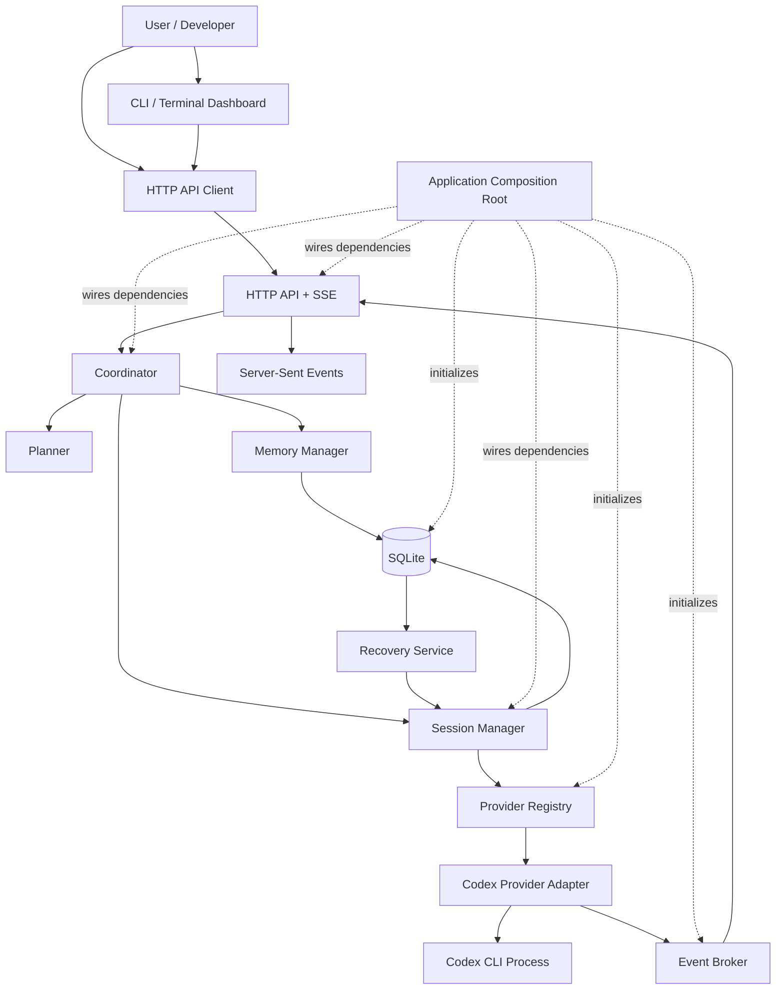

# Agent Orchestrator

Agent Orchestrator is a local Go service that starts and tracks coding-agent tasks. It keeps task and session state in SQLite, provides an HTTP API, and includes a command-line client and interactive terminal dashboard.

The orchestrator owns session coordination and lifecycle. Agent-specific execution lives behind provider adapters. **Today, Codex CLI is the only implemented provider.** This is an early, single-user local MVP.

## Run it locally

### 1. Install prerequisites

- Go 1.26 or newer (the required version is declared in [`go.mod`](go.mod)).
- Codex CLI installed and signed in on the same machine that will run the server. Check with `codex login status`.

### 2. Start the server

Open PowerShell in the repository folder and run:

```powershell
go run ./cmd/server
```

The server listens on `127.0.0.1:8080` by default and creates its SQLite database at `./data/orchestrator.db`.

### 3. Send your first task

Open a second PowerShell window in the repository folder:

```powershell
go run ./cmd/orchestrator doctor
go run ./cmd/orchestrator task create `
  --description "Read the project files and explain what this repository does" `
  --provider codex `
  --workdir .
```

The command prints a session ID when the task is accepted. Acceptance means the agent started; it does not mean the task has finished. Use the session ID to check progress or follow live events:

```powershell
go run ./cmd/orchestrator session get SESSION_ID
go run ./cmd/orchestrator session logs SESSION_ID
go run ./cmd/orchestrator session list
```

Stop a running task with:

```powershell
go run ./cmd/orchestrator session cancel SESSION_ID
```

Press `Ctrl+C` to stop following a log stream. Press `Ctrl+C` in the server window to stop the server.

### Optional: open the interactive dashboard

With the server running, start the terminal UI from another window:

```powershell
go run ./cmd/orchestrator tui
```

### Optional: build command-line binaries

```powershell
go build -o agent-orchestrator.exe ./cmd/orchestrator
go build -o orchestrator-server.exe ./cmd/server
```

Run `./agent-orchestrator.exe --help` to see commands. The CLI is an HTTP client: the server must be running before you use task, session, provider, or memory commands. The `serve` command starts the server.

## Configuration

The server reads environment variables; it does not automatically load a `.env` file. Defaults work for a basic local run. To use a separate database or change the listen address, set these in PowerShell before starting the server:

```powershell
$env:ORCHESTRATOR_HTTP_ADDR = '127.0.0.1:8080'
$env:ORCHESTRATOR_SQLITE_PATH = Join-Path $env:TEMP 'agent-orchestrator.db'
$env:ORCHESTRATOR_ENABLED_PROVIDERS = 'codex'
go run ./cmd/server
```

| Variable | Default | Purpose |
| --- | --- | --- |
| `ORCHESTRATOR_HTTP_ADDR` | `127.0.0.1:8080` | Server listen address. |
| `ORCHESTRATOR_SQLITE_PATH` | `./data/orchestrator.db` | SQLite database path. |
| `ORCHESTRATOR_ENABLED_PROVIDERS` | `codex` | Comma-separated providers to enable. Codex is the only implemented adapter. |
| `CODEX_EXECUTABLE` | Found on `PATH` | Optional path to the Codex executable. |
| `ORCHESTRATOR_SHUTDOWN_TIMEOUT` | `15s` | Grace period for server shutdown and session cleanup. |
| `ORCHESTRATOR_SERVER_URL` | `http://127.0.0.1:8080` | Server URL used by the CLI. |
| `ORCHESTRATOR_MEMORY_ENABLED` | `true` | Whether retrieved memories are added to new task context. |
| `ORCHESTRATOR_MEMORY_CONTEXT_MAX_BYTES` | `4000` | Maximum retrieved context size passed to a provider. |

## What you can do

- Start tasks with an explicitly selected provider and working directory.
- List sessions, inspect their state, cancel active work, and stream live events.
- Check which provider adapters are available at runtime.
- Store, search, archive, and delete provider-independent memories.
- Use the HTTP API directly or through the CLI and terminal dashboard.

The CLI and dashboard communicate with the server over HTTP. They do not access SQLite or launch agent processes directly.

## HTTP API

The local API currently provides:

| Method | Path | Purpose |
| --- | --- | --- |
| `GET` | `/health` | Process liveness check. It does not check database or provider readiness. |
| `POST` | `/api/v1/tasks` | Create and start a task. |
| `GET` | `/api/v1/sessions` | List sessions. |
| `GET` | `/api/v1/sessions/{session_id}` | Read a session snapshot. |
| `POST` | `/api/v1/sessions/{session_id}/cancel` | `accepted` means the orchestrator durably recorded cancellation intent. `provider_acknowledged` is nullable; `provider_acknowledgment_status` distinguishes acknowledged, timed out, and unknown. Provider rejection is an API error. Use `session.status` to determine whether execution terminated; asynchronous providers may remain `cancelling`. |
| `GET` | `/api/v1/sessions/{session_id}/events` | Subscribe to live session events using SSE. |
| `GET` | `/api/v1/providers` | List recognized providers and availability. |
| `GET`, `POST` | `/api/v1/memories` | Search and create memories. |
| `GET`, `DELETE` | `/api/v1/memories/{memory_id}` | Read or permanently delete a memory. |
| `POST` | `/api/v1/memories/{memory_id}/archive` | Archive a memory. |

Example request (Linux/macOS shell):

```bash
curl -X POST http://127.0.0.1:8080/api/v1/tasks \
  -H 'Content-Type: application/json' \
  -d '{"task":{"id":"task-123","description":"Explain this repository","provider":"codex","working_directory":"/path/to/repository"}}'
```

## Memory

Memories are stored in SQLite and are independent of the agent provider. They can be global, task-scoped, or session-scoped, and working, episodic, or semantic. Search uses deterministic lexical matching; it does not use embeddings or a vector database. Expired working memories are excluded from search. Retrieved memories are supplied as untrusted reference context, separate from task instructions.

See [`docs/memory.md`](docs/memory.md) for memory commands, scopes, and API examples.

## Architecture



## Project layout

```text
cmd/server/           Server entry point
cmd/orchestrator/     CLI entry point
internal/domain/      Task, session, event, and memory models
internal/orchestrator/Task coordination and planning
internal/session/     Session lifecycle management
internal/providers/   Provider registry and Codex adapter
internal/api/         HTTP API and event streaming
internal/cli/         HTTP client, commands, and terminal UI
internal/storage/     SQLite persistence
migrations/           Embedded database migrations
docs/                 Guides and architecture decisions
```

## Troubleshooting

**`doctor` cannot connect**

Make sure the server is running. The CLI defaults to `http://127.0.0.1:8080`. If you changed `ORCHESTRATOR_HTTP_ADDR`, point the CLI at the matching URL, for example:

```powershell
$env:ORCHESTRATOR_SERVER_URL = 'http://127.0.0.1:8081'
go run ./cmd/orchestrator doctor
```

**Codex provider is unavailable or task startup fails**

Run `codex --version` and `codex login status` in the environment used to start the server. Check that `ORCHESTRATOR_ENABLED_PROVIDERS` includes `codex` and review the server's startup output.

**You missed session events**

Events are live-only and held in memory. They are not replayed after reconnect or a server restart. Reconnect with `session logs` and use `session get` for the current persisted snapshot.

## Current limitations

- Codex CLI is the only implemented provider. Other provider names are not usable just because the architecture has a provider registry.
- The API has no authentication or authorization. It binds to loopback by default; do not expose it to an untrusted network.
- `/health` checks process liveness only, not readiness.
- Session state is persisted in SQLite, but event history is not.
- Memory search is lexical rather than semantic/vector search.
- Real Codex integration is an opt-in manual verification. See [`docs/codex-integration.md`](docs/codex-integration.md).

## Development

Run the Go tests from the repository root:

```powershell
go test ./...
```

More details:

- [Interactive dashboard](docs/interactive-tui.md)
- [Memory guide](docs/memory.md)
- [Codex integration verification](docs/codex-integration.md)
- [Codex runtime audit and verification limits](docs/codex-runtime-audit.md)
- [Recovery behavior](docs/recovery.md)
- [Architecture specification](SKILL.md)
- [Architecture decisions](docs/decisions/README.md)
